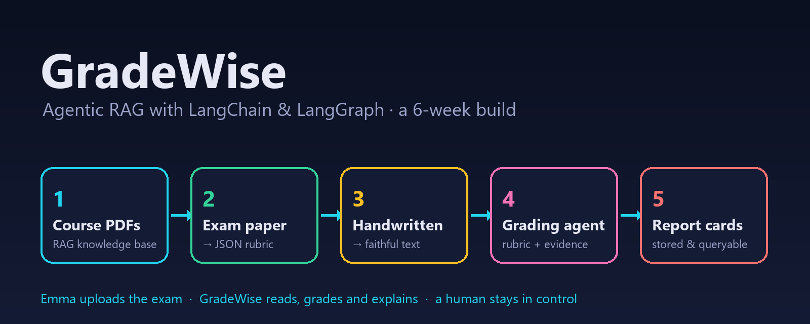
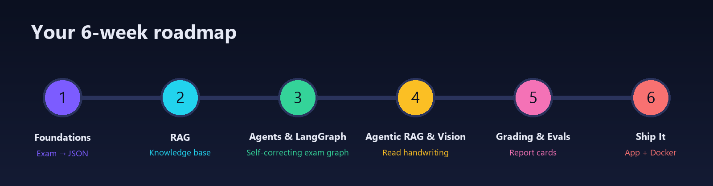

# 🎓 Agentic RAG with LangChain & LangGraph
### 6 weeks to build **GradeWise**: an AI agent that reads handwritten exams, grades them with evidence and writes report cards



_Looking at this in Cursor or VS Code? Right-click `README.md` in the Explorer on the left and choose **"Open Preview"** to see the formatted version._

---

## 👋 Welcome!

I couldn't be more excited to have you here. Over the next six weeks we build one serious, end-to-end agentic system together, and you'll understand every line of it.

Here's the story. **Emma** teaches *CS201 Systems Fundamentals* at the (fictional) **Northbridge Institute**. Every term she spends whole weekends marking handwritten exam scripts. By the end of this course, **GradeWise** will do the heavy lifting for her:

1. 📚 **Learn the course material**: ingest course PDFs into a RAG knowledge base
2. 📝 **Understand the exam**: turn the question paper, marking scheme and methodology into validated JSON
3. ✍️ **Read handwriting**: transcribe each student's answer sheet with a vision model, faithfully
4. ⚖️ **Grade with evidence**: an agent marks every answer against the rubric, citing the course material
5. 📊 **Write report cards**: store them, and let Emma *chat with the results*

And Emma always stays in control: GradeWise asks a human whenever it isn't sure.

---

## 🗺️ The 6-week roadmap



| Week | Theme | GradeWise milestone | Folder |
|:---:|---|---|---|
| **1** | Foundations & your first win | Exam paper → validated JSON | [week1](week1/README.md) |
| **2** | RAG: the knowledge base | Course PDFs → searchable, measured knowledge base | [week2](week2/README.md) |
| **3** | Agents & LangGraph | Self-correcting exam extraction with admin approval | [week3](week3/README.md) |
| **4** | Agentic RAG & reading handwriting | Evidence retriever + handwriting transcription | [week4](week4/README.md) |
| **5** | Grading agent & evaluation | End-to-end grading → report cards, checked against human marks | [week5](week5/README.md) |
| **6** | Ship it | FastAPI + Streamlit app, in Docker, deployed | [week6](week6/README.md) |

Every week runs on the same rhythm: **Days 1–4** teach the ideas (theory first, then hands-on), **Day 5 is project day** when GradeWise gains a new capability, and a **quiz** wraps up the week.

---

## 🛠️ The not-so-dreaded setup instructions

I've worked hard to make this as painless as possible. Pick your platform:

- 🪟 **Windows** people, your instructions are [here](setup/SETUP-PC.md)
- 🍎 **Mac** people, yours are [here](setup/SETUP-mac.md)
- 🐧 **Linux** people, yours are [here](setup/SETUP-linux.md)

When you're done, this one command checks everything and tells you exactly what (if anything) to fix:

```bash
uv run setup/diagnostics.py
```

Stuck? Open [setup/troubleshooting.ipynb](setup/troubleshooting.ipynb). It walks through the most common problems one cell at a time.

---

## 💰 Costs & free mode

This course calls AI models through an API. You need **one key**, `OPENROUTER_API_KEY`, from [openrouter.ai/keys](https://openrouter.ai/keys), and one line in `.env`, `MODEL_MODE`, decides what you pay:

| `MODEL_MODE` | Models | What you need | Expected spend |
|---|---|---|---|
| `cheap` (**the default**) | `openai/gpt-6-luna` for every step ($0.10 / $0.50 per million tokens in / out), `text-embedding-3-small` | your OpenRouter key + a few dollars of credits (OpenRouter adds a small fee when you buy them) | **under $1** for the whole course (a few cents a week) |
| `free` | `openrouter/free`: OpenRouter picks a free model for each call | your OpenRouter key, no credits | **$0** |
| `custom` | whatever your `CHAT_MODEL` / `SMART_MODEL` / `VISION_MODEL` / `EMBEDDING_MODEL` say | the key for that provider (OpenRouter, OpenAI, Gemini, Anthropic), or none for local Ollama | yours to choose |

- 🆓 **Free mode caveats:** 50 requests a day (1,000 a day once you've bought $10 of credits), so **pair it with `DATA_SIZE=small`**: a full class run makes hundreds of calls. The model changes from call to call, so results vary (GradeWise retries the odd hiccup). Free providers may log or train on prompts: fine for this course's fictional data, never OK for real student data. You may need to allow "free endpoints that may train on inputs" in your OpenRouter privacy settings.
- 🚀 **Optional upgrade:** `MODEL_MODE=custom` with `SMART_MODEL=openrouter:openai/gpt-6.1-terra` ($1 / $5 per million tokens) gives you a stronger grader. Calling OpenAI, Gemini, Anthropic or Ollama directly works too: see [setup/SWAP_PROVIDER.md](setup/SWAP_PROVIDER.md).
- 📦 **Just want to run things?** Set `DATA_SIZE=small` and every notebook, script and the app use a slice of the data: 2 PDFs, exam questions Q1–Q3 and 2 students (`student_01` and Sam). Faster, and cheaper still. `DATA_SIZE=full` is the default.
- **Set a spending limit** on your key, and watch your spend in your [OpenRouter activity](https://openrouter.ai/activity) page.

---

## 🗣️ How this repo talks to you

This repo is designed to guide you at every step. Look out for these:

| You'll see | It means |
|---|---|
| A banner at the top of every `.py` file | Which week/day it belongs to, what it does, what came before and what uses it next |
|  **Important** (orange) | A gotcha worth slowing down for |
|  **Exercise** (amber) | Your turn: try it yourself |
|  **Business value** (green) | How this is used in the real world |
|  **Stop & think** (red) | Predict the result before you run the cell |
|  **Resources** (blue) | Further reading |
|  **GradeWise** (violet) | Where this idea lives in our project |
| Green ✅ panels in your terminal | Something worked, plus what to do next |
| Red ❌ panels | Something broke, with the likely cause, the fix and where to read more |

In code comments: `# 💡` explains a concept, `# ⚠️` flags a pitfall, `# 🔁 RECAP` links back to an earlier lesson, `# 🧪 TRY` suggests an experiment, and `# 🚀 PRO` is a production tip beyond the course.

---

## 📁 What's where

```
├── setup/            🛠️ installation guides, diagnostics, troubleshooting
├── guides/           📘 self-study notebooks: command line, git, Python, async, APIs…
├── week1 … week6/    🎬 one folder per week: day1–5 notebooks, exercises, solutions, project code
├── gradewise/        🧱 the finished capstone package (what weeks 1–6 build up to), incl. the API and dashboard
├── data/             📚 knowledge base, exam pack, synthetic answer sheets, golden marks
├── quizzes/          📝 the weekly quizzes + the final quiz (also on Udemy)
├── slides/           🖼️ every week's slide deck (PowerPoint sources)
├── tests/            🧪 the free, offline test suite: uv run python -m pytest -q
├── scripts/          🔧 rebuild the course data, images and diagrams
├── assets/           🎨 banners, roadmaps, callout icons, diagrams and screenshots
├── docker/ · docker-compose.yml   🐳 run the whole app with one command (week 6)
├── output/           📦 everything GradeWise writes while you work (git-ignored)
└── community_contributions/  🤝 share your own extensions here
```

---

## 📚 Super useful resources

- 🖼️ The **slides** for every week: [slides/](slides/README.md)
- 📘 Self-study **guides**, from the command line to async Python: [guides/](guides/01_intro.ipynb)
- 🔗 Every link mentioned in the course, organised by week: [RESOURCES.md](RESOURCES.md)
- 🩺 Something broken? [setup/troubleshooting.ipynb](setup/troubleshooting.ipynb)
- 🤖 Using Cursor or Claude Code? The repo includes an [AGENTS.md](AGENTS.md) so your AI assistant understands the course too.

## 🔄 Keeping up to date

I update this repo as LangChain and the models evolve. Pull the latest at the start of each week:

```bash
git pull
uv sync
```

What changed and when is in [CHANGELOG.md](CHANGELOG.md).

## 🤝 Get in touch & contribute

- Questions? Post in the Udemy Q&A for the lecture you're on: I read them all.
- Built something cool on top of GradeWise? Share it in [community_contributions/](community_contributions/README.md) (see [CONTRIBUTING.md](CONTRIBUTING.md)).
- Let's connect on LinkedIn: _link coming soon_

---

### ⭐ Above all else

Have fun with it! There has never been a better time to learn agentic AI, and you're about to build something genuinely useful. Let's go. 🚀
