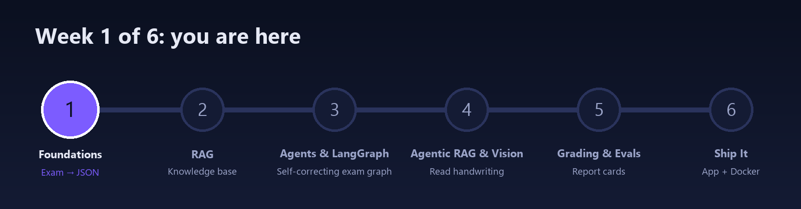

# Week 1: Foundations & Your First Win

> **This week, GradeWise learns to understand an exam.** By Friday, it turns Asha's question paper, marking scheme and methodology into a clean, validated **JSON array**: the backbone everything else builds on.

## 🗓️ The week at a glance

| Day | Notebook | Videos | What you'll do |
|:---:|---|---|---|
| 1 | [day1.ipynb](day1.ipynb) | Welcome demo · 6-week roadmap · setup overview · Windows / Mac setup · API key & diagnostics | Get set up, make your first LLM call, and try a first taste of AI grading |
| 2 | [day2.ipynb](day2.ipynb) | How LLMs work: tokens, context windows, temperature & cost · the LangChain 1.x ecosystem · first calls with `init_chat_model` | Count tokens and dollars for the exam pack; invoke, stream, batch and swap models |
| 3 | [day3.ipynb](day3.ipynb) | Prompting for extraction · structured output with Pydantic · validation, retries & self-correction | Get reliable JSON for one exam question, and a loop that fixes its own mistakes |
| 4 | [day4.ipynb](day4.ipynb) | Multimodal: images & PDF pages · tools & tool calling | Send a PDF page as an image content block; write `@tool`s and a tool loop by hand |
| 5 | [day5.ipynb](day5.ipynb) | 🧱 GradeWise architecture · exam schema → JSON · week wrap-up | **Project day:** the exam pack → `ExamPaper` JSON, diffed field by field against the answer key |

⏱️ About **2 h 50 m** of video (17 lectures), plus the labs at your own pace.

## 🧱 This week's GradeWise milestone
```bash
uv run week1/project/extract_exam.py
```
Reads `data/exams/cs_midterm/` and writes `output/cs_midterm.json`: all 10 questions as **15 markable entries** (sub-parts like `Q7a` and `Q7b` are marked separately), **50 marks**, every criterion accounted for. Day 5 then compares it with the answer key, `data/exams/cs_midterm/expected_exam.json`. More in [project/README.md](project/README.md).

## 💰 Expected API cost this week
Well under **$0.50** with default settings (cents with `BUDGET_MODE=true`). The biggest single call is the Day 5 extraction, at roughly 10,000 tokens in and 11,000 out: a few cents. Most cells in Days 2 to 5 run **offline** and cost nothing.

## 📝 Quiz and 🏋️ exercise
- 📝 **Quiz 1** (10 questions) is on Udemy at the end of the section. Want to practise first? The questions, with an explanation for every option, are in [quizzes/week_1.yaml](../quizzes/week_1.yaml).
- 🏋️ **Exercise:** [week1_EXERCISE.ipynb](week1_EXERCISE.ipynb): add **multiple-choice questions** to the exam schema, by extending it in the notebook (no package edits!). Ten automatic checks tell you how you're doing.
- ✅ Every day's exercise has a reference solution in [solutions/](solutions/).

## 🆘 Stuck?
- Setup problems: run `uv run setup/diagnostics.py`, then see [setup/troubleshooting.ipynb](../setup/troubleshooting.ipynb)
- A red **Missing API key** panel: copy `.env.example` to `.env`, paste your key and **save the file**, then restart the kernel
- Lab problems: compare with [solutions/](solutions/)
- Still stuck: Udemy Q&A for the lecture you're on

⏭ **Next week:** [Week 2: RAG: building GradeWise's knowledge base](../week2/README.md)
