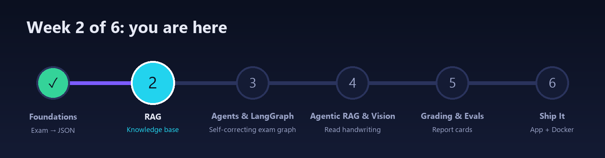

# Week 2: RAG: Building GradeWise's Knowledge Base

> **This week, GradeWise learns the course material.** Last week it learned to understand an exam. This week it reads Asha's four CS201 PDFs, cuts them into well-labelled chunks, stores them in a vector database, and learns to find the right paragraph for any question, with a citation. And because "it seems to work" isn't good enough for marking, by Friday you'll have **numbers** that say how well it works.

## 🗓️ The week at a glance

| Day | Notebook | Videos | What you'll do |
|:---:|---|---|---|
| 1 | [day1.ipynb](day1.ipynb) | Week 2 kickoff · Why RAG? · ⭐ Embeddings visually explained | Closed-book vs open-book answers; build 2-D and 3-D embeddings by hand and rank them by cosine |
| 2 | [day2.ipynb](day2.ipynb) | Chunking strategies · Loading PDFs · Structure-aware chunking | A PyMuPDF vs pymupdf4llm bake-off on Unit 1; fixed vs recursive vs semantic vs structure-aware chunks, side by side |
| 3 | [day3.ipynb](day3.ipynb) | Vector databases & HNSW · A persistent Chroma store · Idempotent ingestion | Collections per course, metadata filters, and an `ingest()` whose second run adds **0** chunks |
| 4 | [day4.ipynb](day4.ipynb) | Retrieval strategies · Hybrid search & reranking · Your first RAG chain | BM25 by hand and on the real chunks, RRF fusion, MMR, multi-query, an LLM reranker, answers with citations |
| 5 | [day5.ipynb](day5.ipynb) | 🧱 Measuring retrieval · 🧱 From simple to pro · Week 2 wrap-up | **Project day:** MRR and nDCG by hand, then `eval.py` on 60 questions; simple vs pro ingestion |

📝 **Quiz 2** (10 questions) is on Udemy at the end of the section · 🏋️ **Exercise:** [week2_EXERCISE.ipynb](week2_EXERCISE.ipynb): tune the chunking and beat the baseline nDCG

## 🧱 This week's GradeWise milestone
Course PDFs → chunked, embedded, searchable knowledge base, with retrieval quality *measured*.

```bash
uv run week2/pro_implementation/ingest.py          # build the knowledge base (run it twice: the second run is free)
uv run week2/pro_implementation/answer.py "What are the four necessary conditions for deadlock?"
uv run week2/evaluation/eval.py --compare          # simple vs pro, MRR / nDCG per category
```

The code lives in three places:
| Folder | What's in it |
|---|---|
| [implementation/](implementation/) | The **simple** version: raw text, fixed-size chunks, dense-only search. Short and honest |
| [pro_implementation/](pro_implementation/) | The **pro** version, built on the `gradewise` package: Markdown loading, structure-aware chunks, idempotent ingestion, hybrid search, citations |
| [evaluation/](evaluation/) | `tests.jsonl` (60 questions), `test.py` (validates it) and `eval.py` (MRR, nDCG, keyword coverage, Source@k). See its [README](evaluation/README.md) |

The reusable pieces are in `gradewise/ingestion/` (loaders, chunking, store, pipeline) and `gradewise/rag/` (retrievers, citations, answer).

## 🔌 No API key? You can still do almost everything
Every notebook runs offline: the vector store demos use LangChain's `DeterministicFakeEmbedding` in a temp folder (the plumbing is real, the similarity is random), and **BM25 needs no embeddings at all**, so `uv run week2/evaluation/eval.py --offline --pipeline bm25` gives real scores for free. The few cells that call a real model say so, and show a friendly error without a key.

## 💰 Expected API cost this week
A few cents at most. Embedding the whole knowledge base with `text-embedding-3-small` costs about **$0.0003**, and re-running ingestion on unchanged PDFs costs **$0**. The optional LLM judge (`eval.py --answers --limit 10`) costs a few cents.

## 🆘 Stuck?
- Setup problems: run `uv run setup/diagnostics.py`, then see [setup/troubleshooting.ipynb](../setup/troubleshooting.ipynb)
- "The knowledge base is empty": run `uv run week2/pro_implementation/ingest.py` first
- Lab problems: compare with [solutions/](solutions/)
- Still stuck: Udemy Q&A for the lecture you're on

⏭ **Next week:** [Week 3: Agents & LangGraph](../week3/README.md)
