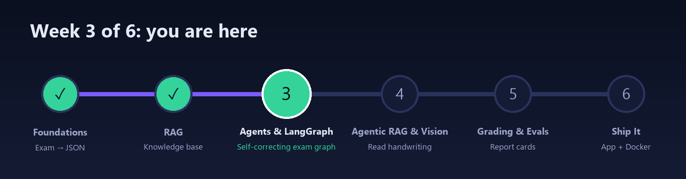
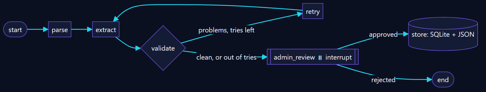
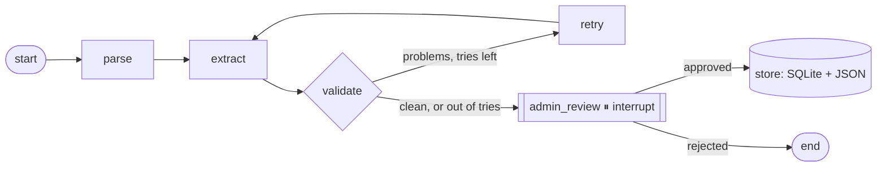

# Week 3: Agents & LangGraph

> **This week, GradeWise learns to check its own work.** By Friday, the week 1 extractor is a LangGraph workflow that validates the exam it extracted, sends its mistakes back to the model to fix, and **pauses for Asha's approval** before anything is saved.

## 🗓️ The week at a glance

| Day | Notebook | Videos | What you'll do |
|:---:|---|---|---|
| 1 | [day1.ipynb](day1.ipynb) | Week 3 kickoff · what is an agent? workflows vs agents and the core patterns · the ReAct loop and designing great tools | Run all five agentic patterns in plain Python, write the ReAct loop by hand, and redesign a bad tool |
| 2 | [day2.ipynb](day2.ipynb) | `create_agent`: tools, memory and structured responses · middleware: logging, summarization, retries, limits, PII, human approval | Build a CS201 rubric assistant, discover it's a graph, and wrap it in middleware |
| 3 | [day3.ipynb](day3.ipynb) | LangGraph concepts: state, nodes, edges, reducers, supersteps · your first `StateGraph` with routing and loops | Build Asha's rubric checker: a check → repair loop with a retry cap |
| 4 | [day4.ipynb](day4.ipynb) | Parallel map-reduce with `Send` · checkpointers and `interrupt()` · subgraphs, streaming and LangGraph Studio | Mark 5 students' answers in parallel, time-travel through checkpoints, and pause for moderation |
| 5 | [day5.ipynb](day5.ipynb) | 🧱 Exam understanding v2: extract → validate → retry → admin approval → store · week 3 wrap-up | **Project day:** run GradeWise's exam graph end to end, pause and resume included |

📝 **Quiz 3** (10 questions) is on Udemy at the end of the section · 🏋️ **Exercise:** [week3_EXERCISE.ipynb](week3_EXERCISE.ipynb): let Asha **edit a question during the interrupt**

💡 **Almost everything this week runs offline, for free.** LangGraph doesn't need an LLM to run a graph, so days 3 and 4 use plain-Python nodes with real CS201 data. Cells that need a real model are marked 🔑; elsewhere, a clearly-labelled 🎭 stand-in model lets you watch agents and the exam graph work without a key.

## 🧱 This week's GradeWise milestone



<details><summary>🔎 Diagram source (Mermaid)</summary>



</details>


```bash
uv run week3/project/exam_graph.py                  # asks you to approve at the end
uv run week3/project/exam_graph.py --auto-approve   # no questions asked
uv run week3/project/exam_graph.py --sqlite         # pause today, approve tomorrow
uv run gradewise exam extract                       # the packaged version (gradewise/exam/graph.py)
```
Reads `data/exams/cs_midterm/`, extracts and validates the exam (retrying with feedback if the marks don't add up), waits for your approval, then saves it to `output/gradewise.db` and `output/cs_midterm.json`. See [project/README.md](project/README.md) for a tour.

## 💰 Expected API cost this week
Around **$0.10–$0.30** with default settings: the 🔑 cells on days 1 and 2 are tiny, and the exam extraction on day 5 is one or two calls with a long prompt. Days 3 and 4 cost **nothing**. (Cents with `BUDGET_MODE=true`.)

## 🆘 Stuck?
- Setup problems: run `uv run setup/diagnostics.py`, then see [setup/troubleshooting.ipynb](../setup/troubleshooting.ipynb)
- Lab problems: compare with [solutions/](solutions/)
- A graph misbehaving? Print it with `graph.get_graph().draw_mermaid()` and paste it into [mermaid.live](https://mermaid.live), or stream it with `stream_mode="updates"` to see every step
- `InvalidUpdateError`: two nodes wrote to the same key in one step; give that key a reducer (day 3)
- Still stuck: Udemy Q&A for the lecture you're on

⏭ **Next week:** [Week 4: Agentic RAG & reading handwriting](../week4/README.md)
