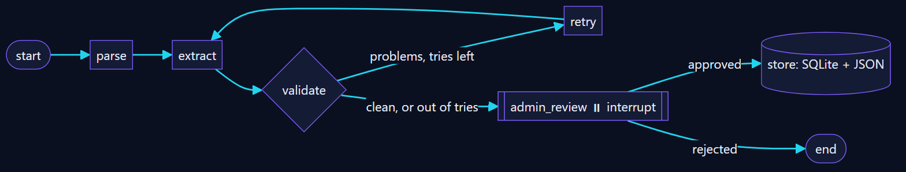
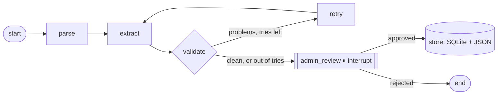

# 🧱 Week 3 project: exam understanding v2, as a graph

In week 1, GradeWise turned Asha's exam pack into JSON with one model call. It worked, but when the marks didn't add up, all it could do was warn you. This week GradeWise learns to **check its own work**, **fix its mistakes**, and **ask a human before saving anything**. 🎉

```bash
uv run week3/project/exam_graph.py                  # asks you to approve at the end
uv run week3/project/exam_graph.py --auto-approve   # no questions asked (demos, CI)
uv run week3/project/exam_graph.py --sqlite         # progress survives closing the terminal
```

## 🗺️ The graph



<details><summary>🔎 Diagram source (Mermaid)</summary>



</details>


- **parse** reads the three PDFs (plus the model answers) into clean Markdown, with repeated page headers and footers stripped.
- **extract** makes the structured-output call. On a retry, the model also sees its **previous answer** and the **list of problems**. That's self-correction, and it's surprisingly effective.
- **validate** runs `ExamPaper.problems()`: do the criteria add up to each question's marks, and do the questions add up to the paper's total?
- **admin_review** calls `interrupt()`. The graph **pauses**, the checkpointer saves everything, and the script shows Asha a summary table. Her answer comes back in through `Command(resume={"approved": True})`.
- **store** saves the approved exam to `output/gradewise.db` (see `gradewise/db.py`) and writes `output/cs_midterm.json`.

## 💡 Things worth noticing
- ⚠️ When the graph resumes, `admin_review` runs again **from the top**, and this time `interrupt()` returns Asha's answer. That's why nothing before `interrupt()` may have side effects.
- With `--sqlite`, press **Ctrl+C** at the approval prompt and run the script again: it picks up the paused review without re-extracting (and without paying for another model call).
- If problems remain after `--max-attempts` tries, the exam still goes to Asha, problems and all. A human decides; GradeWise never quietly saves a flawed exam.

## 🏋️ Exercise
Look for the `✋ TODO` in `admin_review`: let Asha send back `{"approved": True, "edits": {...}}` to fix a question during the interrupt. The packaged version in `gradewise/exam/graph.py` does this, but try it yourself first!

⏭ The packaged version is `gradewise.exam.graph.build_exam_graph()`, which the CLI, the API and the dashboard use in week 6.
