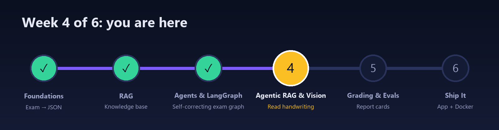

# Week 4: Agentic RAG & Reading Handwriting

> **This week, GradeWise learns to doubt its search, and to read.** By Friday, it finds the right evidence for every exam question, even when a student's answer is wrong, and it turns a handwritten answer-sheet PDF into verbatim, question-by-question text with a confidence score for each answer.

## 🗓️ The week at a glance

| Day | Notebook | Videos | What you'll do |
|:---:|---|---|---|
| 1 | [day1.ipynb](day1.ipynb) | Week 4 kickoff · the agentic RAG spectrum (Adaptive, Corrective, Self-RAG) · building the agentic RAG graph | Build a retrieve → grade → rewrite → answer loop from scratch, then draw and run GradeWise's, offline |
| 2 | [day2.ipynb](day2.ipynb) | Grounded answers: citations and hallucination checks · 🧱 the evidence retriever | Catch invented citations and unsupported claims; fetch marking evidence for the deadlock question |
| 3 | [day3.ipynb](day3.ipynb) | OCR vs HTR vs vision LLMs · PDF pages to images: DPI, rotation, contrast | Render real handwritten sheets, measure DPI vs pixels vs tokens, clean up a phone photo |
| 4 | [day4.ipynb](day4.ipynb) | Faithful transcription (never "fix" the student) · mapping answers to questions · confidence and double-pass checks | Prove with CER why fixing spelling is wrong; map "Ans 4(ii)" to `Q4b`; score and verify each answer |
| 5 | [day5.ipynb](day5.ipynb) | 🧱 The transcription subgraph, tuned for cost and latency · week wrap-up | **Project day:** answer-sheet PDF → `AnswerSheet`, in parallel, with cost logging |

📝 **Quiz 4** (10 questions) is on Udemy at the end of the section · 🏋️ **Exercise:** [week4_EXERCISE.ipynb](week4_EXERCISE.ipynb): compare two vision models on CER and cost

## 🧱 This week's GradeWise milestone
An evidence retriever for grading, plus a transcription subgraph: handwritten PDF → page images → faithful text, mapped to question IDs with confidence scores.

```bash
uv run week4/project/transcription_graph.py data/answer-sheets/synthetic/student_07.pdf
```
Reads one synthetic answer sheet, prints each answer with its pages, confidence and **CER** against the ground truth, and saves the `AnswerSheet` to `output/transcriptions/student_07.json`, ready for week 5's grader. The other two demos:

```bash
uv run week4/project/agentic_rag.py --diagram     # free: prints the agentic RAG graph as Mermaid
uv run week4/project/agentic_rag.py "Why does breaking circular wait prevent deadlock?"
uv run week4/project/evidence.py                  # evidence passages for a deadlock question
```
See [project/README.md](project/README.md) for what happens under the hood.

| New this week | Lives in |
|---|---|
| Agentic RAG graph (route, retrieve, grade, rewrite, answer) | `gradewise/rag/agentic_rag.py` |
| Evidence retriever for grading | `gradewise/rag/evidence.py` |
| PDF → images, pre-processing, token estimates | `gradewise/transcription/pdf_to_images.py` |
| Verbatim transcription prompt + `transcribe_page` | `gradewise/transcription/vision.py` |
| Label normalisation + answer mapping | `gradewise/transcription/mapper.py` |
| CER / WER, confidence, double-pass verification | `gradewise/transcription/confidence.py` |
| The transcription subgraph | `gradewise/transcription/graph.py` |

## 💰 Expected API cost this week
Most of this week runs **offline and free**: a keyword-only (BM25) copy of the knowledge base and fake, scripted models let you watch every graph work without a key. The real calls are small: a few cents for Days 1–4, about **1–3 cents per answer sheet** for the transcription demo, and well under **$0.50** for the exercise on three sheets with two models. With `BUDGET_MODE=true`, the vision model falls back to your (cheaper) `CHAT_MODEL`: make sure it accepts images.

## 🏋️ Quiz & exercise
- **Quiz 4** on Udemy: 10 questions on agentic RAG, grounding, DPI and tokens, faithful transcription and confidence.
- **[week4_EXERCISE.ipynb](week4_EXERCISE.ipynb):** run the same synthetic sheets through two vision models, score them with CER and WER, log tokens, cost and time, and write Asha a recommendation. It starts in a free dry-run mode.
- Reference solutions for every lab exercise and the week exercise are in [solutions/](solutions/).

## 🆘 Stuck?
- **No synthetic answer sheets?** Run `uv run scripts/make_synthetic_sheets.py` (or `git pull`). The Day 3–5 notebooks fall back to a small stand-in sheet so you can still follow along.
- **"Missing API key" panel?** That's expected without a key: those cells are clearly marked. See Part 5 of `setup/SETUP-PC.md` (or `-mac` / `-linux`).
- **The Mermaid diagram shows as text?** JupyterLab 4.1+ and recent VS Code render it; elsewhere, paste the printed text into [mermaid.live](https://mermaid.live).
- **Tests:** `uv run python -m pytest tests/test_transcription.py tests/test_rag.py -q` (free, no network)
- Setup problems: run `uv run setup/diagnostics.py`, then see [setup/troubleshooting.ipynb](../setup/troubleshooting.ipynb)
- Lab problems: compare with [solutions/](solutions/)
- Still stuck: Udemy Q&A for the lecture you're on

⏭ **Next week:** [Week 5: The grading agent, report cards & evaluation](../week5/README.md)
