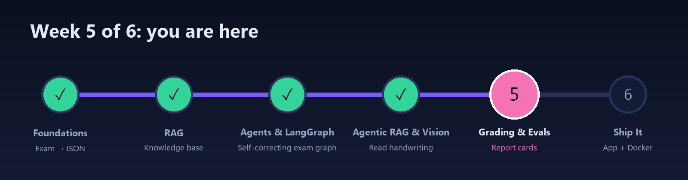

# Week 5: The Grading Agent, Report Cards & Evaluation

> **This week, GradeWise learns to grade, and we prove it's fair.** By Friday, it marks every answer on a script in parallel, criterion by criterion, with evidence from the course notes and guardrails the model can't talk its way past; writes report cards students can act on; pauses for Asha whenever a human should decide; and measures itself against a human examiner on a golden set.

## 🗓️ The week at a glance

| Day | Notebook | Videos | What you'll do |
|:---:|---|---|---|
| 1 | [day1.ipynb](day1.ipynb) | Week 5 kickoff · LLM-as-grader: rubrics, bias, consistency and human oversight · ⭐ grade one answer | Build the rubric + answer + evidence prompt, a structured grader from scratch, then run `grade_answer()` on Sam's deadlock answer |
| 2 | [day2.ipynb](day2.ipynb) | Grading tools · grading every question in parallel with `Send` · guardrails, self-consistency and prompt-injection defence | Tools that read a `ToolRuntime` context, a `Send` fan-out per question, and a real injection attempt that fools a naive grader but not GradeWise |
| 3 | [day3.ipynb](day3.ipynb) | Writing the report card (HTML/PDF) · storing reports and the "chat with results" agent | Render report cards inline and as PDF, store them in SQLite + Chroma, and question the results agent |
| 4 | [day4.ipynb](day4.ipynb) | 🧱 The orchestrator, end to end · LangSmith tracing, costs and debugging | Run a batch, pause at `human_review`, "restart Python", resume with a teacher override; switch on LangSmith |
| 5 | [day5.ipynb](day5.ipynb) | 🧱 Golden set, MAE and quadratic weighted kappa · CER/WER and regression tests · week wrap-up | **Project day:** metrics by hand, the stand-in's QWK of ≈ 0.85 as the baseline to beat, a `pytest` quality gate |

📝 **Quiz 5** (10 questions) is on Udemy at the end of the section · 🏋️ **Exercise:** [week5_EXERCISE.ipynb](week5_EXERCISE.ipynb): add a moderation second-grader for borderline marks

## 🧱 This week's GradeWise milestone
Parallel, evidence-based grading → report cards → a "chat with results" agent, evaluated against human marks (MAE, exact agreement, quadratic weighted kappa).

```bash
uv run week5/project/orchestrator.py --fake --students 3          # free: the whole pipeline with a stand-in grader
uv run week5/project/orchestrator.py --from-transcripts --students 3   # your real grader, no vision calls
uv run week5/project/orchestrator.py --students 2                 # everything real, from the handwritten PDFs
```
It grades the batch, stops to ask **you** about anything flagged (try `--auto-approve` to skip that), and writes HTML + PDF report cards to `output/reports/cs_midterm/`. Then:

```bash
uv run week5/project/grade_one.py --student student_05 --question Q3   # one answer, criterion by criterion
uv run week5/project/report_qa.py                                      # chat with the results
uv run week5/evaluation/run_evals.py --fake                            # the baseline (free)
uv run week5/evaluation/run_evals.py --grade                           # your real grader vs the human examiner
```
Every script has a `--fake` mode. See [project/README.md](project/README.md) and [evaluation/README.md](evaluation/README.md) for what happens under the hood.

| New this week | Lives in |
|---|---|
| The examiner prompt (the handbook's 10 marking principles) | `gradewise/grading/prompts.py` |
| `retrieve_reference` · `get_rubric` · `flag_for_review`, with `ToolRuntime[GradingContext]` | `gradewise/grading/tools.py` |
| `grade_answer()`: the grading agent + guardrails | `gradewise/grading/grader.py` |
| Rubric enforcement, injection tripwire, blanks, self-consistency, middleware | `gradewise/grading/guardrails.py` |
| `build_grading_graph()` / `grade_sheet()`: `Send` per question | `gradewise/grading/graph.py` |
| Report cards (feedback, HTML, PDF), storage, the results agent | `gradewise/reports/` |
| The orchestrator: `grade_batch()`, `resume_batch()`, interrupts, `on_event` | `gradewise/orchestrator.py` |
| MAE, exact, within-1, QWK, CER/WER | `gradewise/evals/` |

## 💰 Expected API cost this week
Most of this week runs **offline and free**: a keyword-only (BM25) copy of the knowledge base and clearly labelled stand-in graders let you watch every step (the `Send` fan-out, the human-review interrupt and resume, report cards, the eval tables) without a key. The real calls: a few cents each for Days 1–3, a few cents per student for Day 4's end-to-end run from a handwritten PDF, a few tens of cents for Day 5's three-student evaluation, and roughly a dollar to grade the full golden set (10 students × 15 questions) with the default `SMART_MODEL`. Costs depend heavily on your model: check your provider's pricing page, and `get_usage_metadata_callback()` (Day 4) tells you the tokens per answer. `--runs 3` (self-consistency) triples the grading cost. **LangSmith** has a free tier.

## 🏋️ Quiz & exercise
- **Quiz 5** on Udemy: 10 questions on LLM graders, `ToolRuntime`, `Send` and reducers, guardrails and prompt injection, interrupts, and when each metric lies.
- **[week5_EXERCISE.ipynb](week5_EXERCISE.ipynb):** add a **moderation second-grader**: decide which marks are borderline, have an independent second grader re-mark only those, agree a mark or escalate to Asha, and prove on the golden set whether it's worth the cost. It starts in a free dry-run mode with two stand-ins.
- Reference solutions for every lab exercise and the week exercise are in [solutions/](solutions/).

## 🆘 Stuck?
- **"Missing API key" panel?** That's expected without a key: those cells are marked 🔑 and the rest of the notebook carries on. See Part 5 of `setup/SETUP-PC.md` (or `-mac` / `-linux`).
- **The report card shows as raw HTML?** Trust the notebook (JupyterLab: *File → Trust Notebook*; VS Code trusts it when you run it), or open the file in `output/week5/day3/reports/` in your browser.
- **`import pandas` fails with "DLL load failed"?** A locked-down Windows machine blocks pyarrow. GradeWise imports pandas through `gradewise.evals.compat.import_pandas()`, which works around it; do the same in your own cells.
- **A batch is stuck "paused"?** That's an interrupt waiting for a decision: `resume_batch(thread_id, {"approved": True, "overrides": {}})`, or re-run the CLI with `--thread <id>`.
- **LangSmith shows nothing?** `LANGSMITH_TRACING=true` *and* `LANGSMITH_API_KEY` must be in `.env`, saved, and the kernel restarted.
- **Tests:** `uv run python -m pytest tests/test_grading.py tests/test_reports.py tests/test_orchestrator.py tests/test_evals.py -q` (free, no network)
- Setup problems: run `uv run setup/diagnostics.py`, then see [setup/troubleshooting.ipynb](../setup/troubleshooting.ipynb)
- Lab problems: compare with [solutions/](solutions/)
- Still stuck: Udemy Q&A for the lecture you're on

⏭ **Next week:** [Week 6: Ship it: app, Docker, deployment & wrap-up](../week6/README.md)
