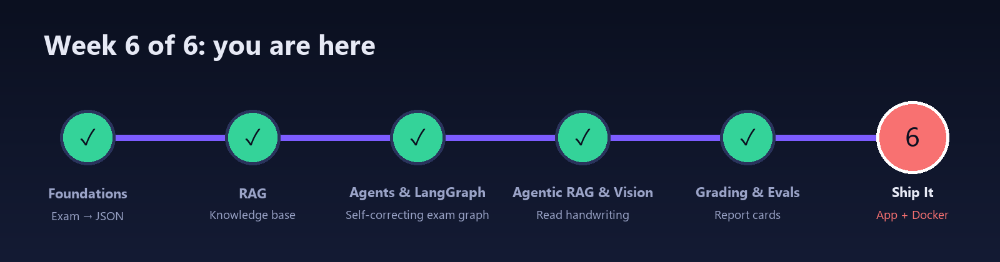

# Week 6: Ship It: App, Docker, Deployment & Wrap-Up

> **This week, GradeWise becomes a real product.** By Friday, Asha opens a browser, uploads a pile of scripts, watches them being graded live, decides on the uncertain marks in a review queue, reads every report card and asks questions about the results. It all runs with one command, `docker compose up`, and it's ready to deploy. Then we talk honestly about grading responsibly with AI, run the whole capstone in one cell, and celebrate the end of the course. 🎓

## 🗓️ The week at a glance

| Day | Notebook | Videos | What you'll do |
|:---:|---|---|---|
| 1 | [day1.ipynb](day1.ipynb) | Week 6 kickoff · production architecture: API, workers, UI, storage · FastAPI backend: upload, run and status endpoints | Build a mini FastAPI app, then drive the real GradeWise API with `TestClient`: health, uploads, a `202` batch, polling, review and reports |
| 2 | [day2.ipynb](day2.ipynb) | Streamlit admin dashboard · the review queue: approving flags and overriding marks | Streamlit's re-run model, a tour of every page, and the **real review queue run headlessly** to override a mark |
| 3 | [day3.ipynb](day3.ipynb) | Streaming grading progress from LangGraph to the UI · report card viewer and chat with results | Custom stream events → SSE by hand → a live GradeWise batch with reconnects and live progress bars; report cards and chat |
| 4 | [day4.ipynb](day4.ipynb) | One command to run it all: Docker Compose · deploying GradeWise (Render / Fly.io / HF Spaces) | The Dockerfile and compose file line by line, a build-cache simulator, the real health check, and a deploy pre-flight checklist |
| 5 | [day5.ipynb](day5.ipynb) | Responsible AI grading · 🏆 capstone showcase · where next · your portfolio piece · the final roadmap and thank you | **Project day:** principle-by-principle responsible AI, the whole product in one cell, an MCP sketch, and the finish line |

⏱️ About **2 h 20 m** of video (14 lectures), plus the labs at your own pace.

## 🧱 This week's GradeWise milestone
FastAPI backend + Streamlit dashboard (review queue, live progress, report viewer, chat), in Docker, ready to deploy.

```bash
docker compose up --build                     # API on :8000, dashboard on http://localhost:8501
```

No Docker yet? Two terminals do the same (free demo mode, no API key):

```bash
uv run python -m gradewise.api --demo                 # terminal 1: the API (docs at http://localhost:8000/docs)
uv run python -m streamlit run gradewise/ui/app.py    # terminal 2: the dashboard
```

The full guide to the app is [project/README.md](project/README.md), and deploying it to Hugging Face Spaces, Render, Fly.io or LangGraph Platform is in [project/DEPLOY.md](project/DEPLOY.md).

| New this week | Lives in |
|---|---|
| The API: `create_app()`, every route, friendly errors | `gradewise/api/main.py`, `schemas.py` |
| Background batches and their numbered progress events | `gradewise/api/jobs.py` |
| Where files go, and the 🧪 demo-mode switch | `gradewise/api/workspace.py`, `demo.py` |
| The dashboard: shell, HTTP client, shared pieces, look | `gradewise/ui/app.py`, `client.py`, `common.py`, `styles.py` |
| Seven pages, including the review queue | `gradewise/ui/pages/` |
| One image, two services, one volume | `docker/Dockerfile`, `docker-compose.yml`, `.dockerignore` |
| `serve api` / `serve ui` | `gradewise/cli.py` (`uv run python -m gradewise serve api --demo`) |
| Tests that drive the whole API offline | `tests/test_api.py` |

## 💰 Expected API cost this week
**$0.** Every notebook runs offline in 🧪 demo mode: the real API, background jobs, interrupts, streaming and storage, with stand-in models. When you switch demo mode off in the dashboard (with a key in `.env`), costs are the same as week 5's orchestrator: a few cents per student with the defaults, much less with `from_transcripts` or `BUDGET_MODE=true`. Hosting: Hugging Face Spaces is free for a demo-mode portfolio app; Render or Fly.io with a persistent disk is roughly $5–10/month. **Deploy public demos with `GRADEWISE_DEMO=true`**, and set a spending cap before you share a link with real models behind it.

## 📝 Quizzes and 🏋️ the final exercise
- 📝 **Quiz 6** (6 questions) is on Udemy at the end of the section. Practise first with [quizzes/week_6.yaml](../quizzes/week_6.yaml).
- 🎓 **The final quiz** (20 questions across all six weeks) follows it: [quizzes/final.yaml](../quizzes/final.yaml).
- 🏋️ **Exercise:** [week6_EXERCISE.ipynb](week6_EXERCISE.ipynb): **ship your own variant of GradeWise**. Pick a subject, write course notes and an exam, invent a few students, run it end to end through the API, and package it for [community_contributions/](../community_contributions/README.md). Runs as-is with a tiny starter subject, offline.
- ✅ Every exercise has a reference solution in [solutions/](solutions/), including a complete BIO101 variant.

## 🆘 Stuck?
- **"Can't reach the GradeWise API"** in the dashboard? The API isn't running, or `API_URL` points elsewhere. Start it with `uv run python -m gradewise.api --demo` (and keep that terminal open).
- **Windows: "This program is blocked"** when starting Streamlit or uvicorn? Use `uv run python -m streamlit ...` / `uv run python -m gradewise.api`, never the `.exe` launchers.
- **A batch is stuck on "paused"?** That's a human-in-the-loop interrupt: open the 🔍 Review queue, or `POST /batches/{id}/review`. After a restart, the job *list* is gone (it lives in memory) but the checkpoints aren't: see `gradewise/api/jobs.py`.
- **Port 8000 or 8501 already in use?** Another copy is running. Stop it, or pass `--port 8001` (and set `API_URL` to match).
- **Docker: the dashboard says the API is offline?** Check `docker compose ps`: the `api` must be *healthy*; `docker compose logs api` shows why it isn't. Inside Compose the UI uses `API_URL=http://api:8000`, not `localhost`.
- **The report card shows raw HTML** in a notebook? Trust the notebook (JupyterLab: *File → Trust Notebook*).
- **Tests:** `uv run python -m pytest tests/test_api.py -q` (free, no network)
- Setup problems: run `uv run setup/diagnostics.py`, then see [setup/troubleshooting.ipynb](../setup/troubleshooting.ipynb)
- Lab problems: compare with [solutions/](solutions/)
- Still stuck: Udemy Q&A for the lecture you're on

## 🎓 That's the course!
Six weeks ago GradeWise was one prompt and a mark you couldn't trust. Now it's a shipped product with evidence, guardrails, evaluation and a teacher in the loop. Thank you for building it with us. Share your version in [community_contributions/](../community_contributions/README.md), put the live link in your portfolio, and go build something wonderful. 🚀

⏮ **Back to the start:** [the course README](../README.md)
