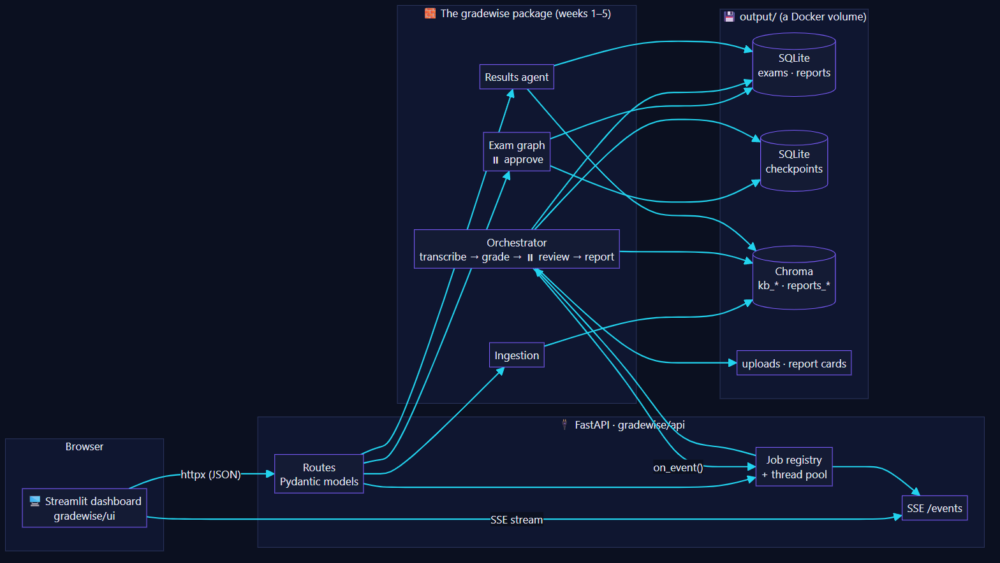
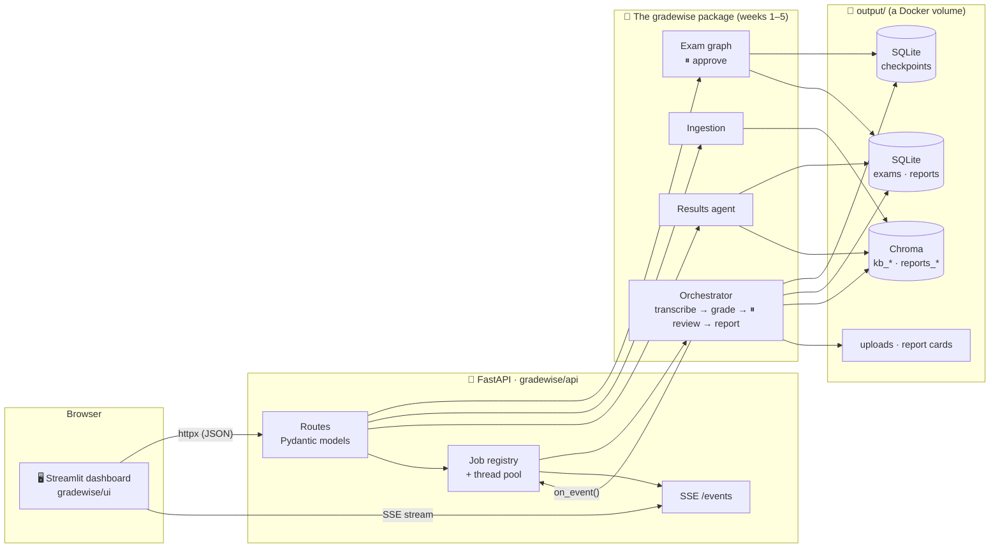

# 🚢 Week 6 project: GradeWise, the app

> **Milestone M6.** Everything you built in weeks 1 to 5 now sits behind a FastAPI backend, with a Streamlit dashboard on top and Docker around both. Asha can open a browser, upload a pile of scripts, watch them being graded live, decide on the uncertain marks, and read every report card. No notebook required.

The app code lives in the package, not in this folder:

| Piece | Where | What it does |
|---|---|---|
| 🔌 API | [`gradewise/api/`](../../gradewise/api/) | FastAPI: uploads, background batches, SSE progress, review, reports, chat |
| 🖥️ Dashboard | [`gradewise/ui/`](../../gradewise/ui/) | Streamlit multipage app that only talks to the API over HTTP |
| 🐳 Containers | [`docker/Dockerfile`](../../docker/Dockerfile), [`docker-compose.yml`](../../docker-compose.yml) | One image, two services, one shared volume |
| 🚀 Deploying | [`DEPLOY.md`](DEPLOY.md) | Render, Fly.io, Hugging Face Spaces, LangGraph Platform |

## 🏃 Run it locally (two terminals)

```bash
# Terminal 1: the API (http://localhost:8000, interactive docs at /docs)
uv run python -m gradewise.api --demo

# Terminal 2: the dashboard (http://localhost:8501)
uv run python -m streamlit run gradewise/ui/app.py
```

> ⚠️ **Windows PC people:** always use `uv run python -m ...`, not `uv run streamlit ...` or `uv run uvicorn ...`. On locked-down machines, Windows Application Control can block freshly created `.exe` launchers, while `python -m` always works.

The dashboard finds the API through `API_URL` (default `http://localhost:8000`). The API listens on `API_HOST` / `API_PORT` (default `127.0.0.1:8000`; use `--host 0.0.0.0` in a container).

### Or with Docker, in one command

```bash
docker compose up --build                        # uses the keys in your .env
GRADEWISE_DEMO=true docker compose up --build    # Mac / Linux: the free demo
docker compose --profile ollama up --build       # adds a local Ollama server
```

## 🧪 Demo mode: the whole product, no API key

Demo mode swaps every model for an offline fake (see [`gradewise/api/demo.py`](../../gradewise/api/demo.py)), so every page and every endpoint works for free, on a plane, or in CI:

| Real step | In demo mode |
|---|---|
| Exam extraction (chat model) | Returns the bundled CS201 midterm, whatever you upload. The **approval interrupt is real**. |
| Handwriting (vision model) | Synthetic students get their known transcript; any other PDF gets blank answers that pause for a human transcription check. |
| Grading (grading model) | Week 5's keyword examiner. It's "unsure" about half marks or less, so the review queue has work in it. |
| Embeddings | `DeterministicFakeEmbedding` + BM25 keyword search, so the evidence citations are still real. |
| Chat with results | Picks one of the four tools and shows you its raw output. |

Turn it on with `--demo`, with `GRADEWISE_DEMO=true` in `.env`, with `demo=true` on any request, or with the 🧪 toggle in the dashboard's sidebar. Demo data lives in `output/demo/`, so fake marks never mix with real ones.

> ⚠️ Demo marks mean **nothing**. Demo mode tests the plumbing (uploads, jobs, interrupts, streaming, storage), not the judgement.

## 🛣️ The endpoints

Open http://localhost:8000/docs for the live, clickable version.

| Method | Path | What it does |
|---|---|---|
| GET | `/health` | Is it up? Default mode, models, jobs by state |
| GET | `/knowledge-bases` | Collections and chunk counts |
| POST | `/knowledge-bases/{name}/documents` | Upload PDFs (and/or `include_course_notes=true`), then ingest |
| POST | `/exams` | Upload question paper + marking scheme + methodology (or `use_sample=true`). Runs the week 3 graph and returns the **interrupt**: the exam awaiting approval |
| POST | `/exams/{id}/approve` | `{"approved": true, "edits": {...}}` resumes the graph and stores the exam |
| GET | `/exams`, `/exams/{id}` | Approved exams (plus the bundled sample) |
| POST | `/batches` | `exam_id` + answer PDFs, or `use_synthetic=true`, or `from_transcripts=true`. Starts a background job, returns `batch_id` at once (202) |
| GET | `/batches`, `/batches/{id}` | Status, per-student progress, and the pending review items with full context |
| GET | `/batches/{id}/events` | **Server-Sent Events**: every progress event, then `event: end` |
| POST | `/batches/{id}/review` | `{"overrides": {"Q7a": 1.5}, "approved": true}` (or `corrections` for transcription) resumes the batch |
| GET | `/reports/{exam_id}` | Class overview: totals, bands, per-question means (hardest first) |
| GET | `/reports/{exam_id}/{student_id}` | One report card: JSON, `?format=html` or `?format=pdf` |
| POST | `/ask` | `{"question": "...", "exam_id": "cs_midterm"}` → the results agent's answer |

Every error has the same friendly shape as `GradeWiseError` in the terminal: `{"error", "what", "cause", "fix", "help"}`.

Try a whole batch from the terminal:

```bash
curl -X POST localhost:8000/batches -F exam_id=cs_midterm -F from_transcripts=true -F students=3 -F demo=true
curl -N localhost:8000/batches/<batch_id>/events          # -N: show the stream as it arrives
curl localhost:8000/batches/<batch_id>                     # status + what's waiting for review
curl -X POST localhost:8000/batches/<batch_id>/review -H "Content-Type: application/json" \
     -d '{"overrides": {"Q4a": 2}, "approved": true}'
```

## 🧱 Architecture



<details><summary>🔎 Diagram source (Mermaid)</summary>



</details>


**Why it's shaped like this**
- **The UI only speaks HTTP.** It never imports LangGraph or opens the database, so it can live in its own container, or be replaced by a React app, without touching the backend.
- **Long work never blocks a request.** `POST /batches` returns in milliseconds; a worker thread runs `grade_batch(on_event=...)`, and each event is replayed over SSE.
- **Interrupts survive restarts.** The batch and exam graphs checkpoint to SQLite, so a paused review is still there tomorrow. 🚀 The job *list* is in memory; [`jobs.py`](../../gradewise/api/jobs.py) explains the production upgrade (a queue + Redis + Postgres checkpoints).

## ✅ Tests

```bash
uv run python -m pytest tests/test_api.py -q
```

Every test builds its own app on a temporary folder in demo mode: health, the exam upload → interrupt → approve flow, a two-student batch that pauses for review and then completes, the SSE stream, reports as JSON/HTML/PDF, `/ask`, and ingestion.

## 🏋️ Make it yours
- ✋ Add `DELETE /batches/{id}` that cancels a running batch.
- ✋ Add a "re-grade this student" button to the Reports page (hint: a one-student batch with the same exam).
- 🧪 Put the API behind a password: FastAPI's `HTTPBearer` dependency plus a `GRADEWISE_TOKEN` secret.
